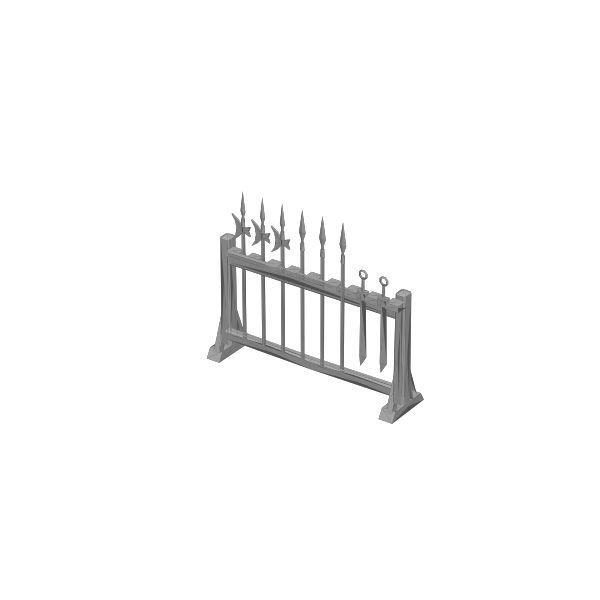
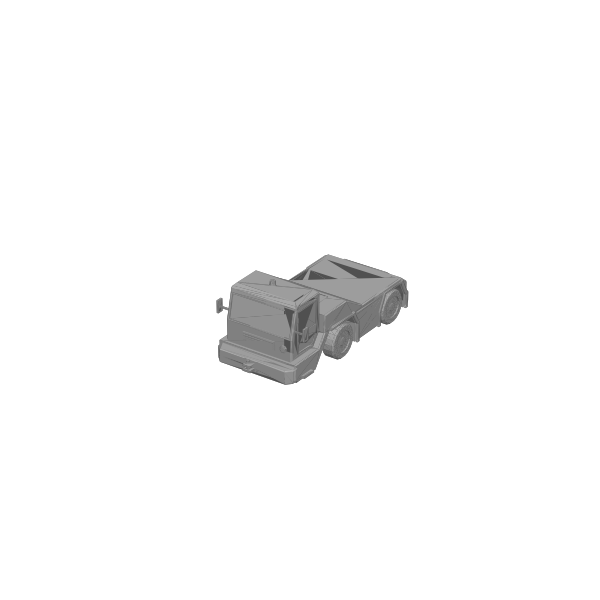
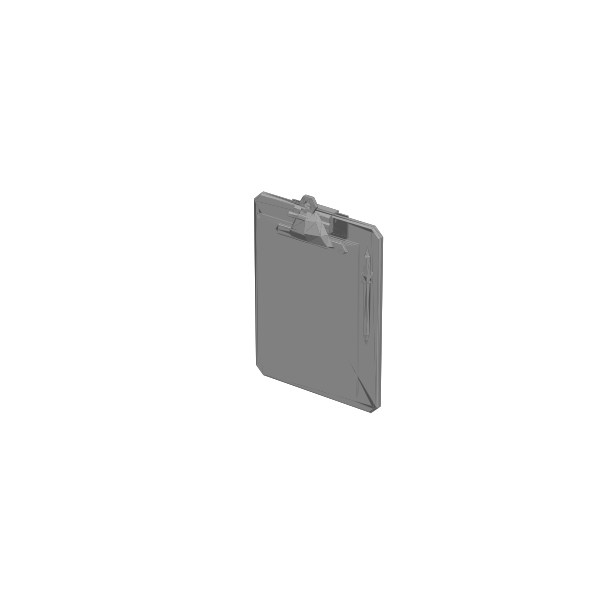

# 3D 에셋 (Polyfork)

[Polyfork](https://polyfork.dev)의 무료 로우폴리 3D 모델(GLB)을 **CC BY 4.0** 라이선스로 자동 수집하는 저장소입니다. GitHub Actions가 15분마다 새 모델을 확인해 에셋마다 미리보기 이미지, 메타 정보, 라이선스 사본, 크레딧 표기 문구까지 함께 정리해 둡니다. 게임 프로젝트에서 바로 내려받아 쓸 수 있는 형태가 목표입니다.

전체 에셋 목록은 중앙 카탈로그 [game-asset-catalog](https://github.com/sigco3111/game-asset-catalog)에서 확인하세요.

## 수록 에셋

현재 3종이 수록돼 있으며, 자동 수집이 진행되는 동안 계속 늘어납니다.

| 미리보기 | 이름 | 원본 |
| --- | --- | --- |
|  | **Han Weapon Rack** — 창·도끼 등을 세워 두는 목재 무기 거치대 | [polyfork.dev](https://polyfork.dev/asset/han-weapon-rack-b51a33) |
|  | **Pushback Tug** — 항공기를 밀어내는 공항 견인 차량 | [polyfork.dev](https://polyfork.dev/asset/pushback-tug-8eab46) |
|  | **Waybill Clipboard** — 집게 달린 클립보드 소품 | [polyfork.dev](https://polyfork.dev/asset/waybill-clipboard-05bd4a) |

미리보기는 수집 러너가 GLB 메시를 직접 렌더링한 이미지입니다. 원본 모델의 텍스처 구성에 따라 무채색으로 보일 수 있습니다.

## 사용 방법

1. 원하는 에셋 폴더에서 `<이름>.zip`을 내려받습니다. zip 안에 GLB 모델 파일 하나가 들어 있습니다.
2. 저장소 전체가 필요하면 통째로 clone 합니다.
3. 사용하는 프로젝트에 크레딧을 표기합니다(CC BY 4.0 의무). 각 폴더의 `CREDITS.txt`에 그대로 복사해 쓸 수 있는 표기 문구가 있습니다. 예:
   `Han Weapon Rack by Polyfork (https://polyfork.dev/asset/han-weapon-rack-b51a33), CC BY 4.0`

## 자동 수집 방식

수집은 [.github/workflows/auto-collect-polyfork.yml](.github/workflows/auto-collect-polyfork.yml) 하나가 담당합니다.

- **실행 주기**: 15분마다(cron), `workflow_dispatch` 수동 실행, 또는 `triggers/polyfork-live.txt` 변경 푸시로도 실행됩니다. 한 번 실행할 때 최대 3개까지 추가합니다.
- **대상 선정**: Polyfork 공개 API에서 무료 모델을 최신순으로 조회(삼각형 5,000개 이하)한 뒤, 상세 정보에서 라이선스가 CC BY 4.0이고 크레딧이 Polyfork로 명시된 것만 다시 확인해 통과시킵니다.
- **제외 규칙**: 스켈레톤(리깅) 포함 모델, 캐릭터·동물 클래스, 할로윈·크리스마스 같은 시즌성 모델, 5MB를 넘는 파일은 건너뜁니다. 건너뛴 항목은 사유와 함께 [docs/polyfork-skip.txt](docs/polyfork-skip.txt)에 기록하고, 이미 수집한 모델은 URL·이름·폴더를 대조해 중복 수집하지 않습니다.
- **미리보기 렌더링**: 러너에서 trimesh로 GLB를 읽어 matplotlib 3D로 정면 구도의 600×600 PNG를 직접 그립니다. 렌더링에 실패하면 그 에셋은 수록하지 않습니다.
- **안전 장치**: 저장소 크기가 650MB를 넘으면 수집을 멈추고, `triggers/polyfork-stop.txt` 등 중단 스위치 파일이 있으면 실행 즉시 종료합니다. 커밋·푸시는 rebase 후 재시도 방식으로 처리해 자동 수집과 수동 커밋이 겹쳐도 충돌하지 않게 했습니다.
- **기술 스택**: GitHub Actions(ubuntu-latest), Python 3, trimesh·numpy·matplotlib·Pillow.

## 폴더 구성

```
<asset-slug>/
  <asset-slug>.zip      # GLB 모델 원본
  preview.png           # 러너가 GLB를 직접 렌더링한 미리보기
  meta.json             # 이름, 출처 URL, 라이선스, 크레딧 문구, 수집일
  pack.md               # 사람이 읽기 위한 요약
  CREDITS.txt           # 복사해 쓰는 크레딧 표기
  LICENSE.txt           # CC BY 4.0 전문
  LICENSE-SOURCE.txt    # 라이선스 확인 근거(확인일, 확인 주소)
docs/polyfork-skip.txt  # 건너뛴 모델과 사유
triggers/               # 수동 실행·중단 스위치
```

## 라이선스 · 원작 표기

- 수록된 각 3D 모델: **CC BY 4.0**, 제작자 **Polyfork** — https://polyfork.dev/licensing
- 크레딧 표기가 필요하며, 모델별 표기 문구는 각 폴더의 `CREDITS.txt`를 따릅니다.
- Polyfork의 썸네일·렌더 이미지, HD 모델, `.mjs` 소스는 CC BY 범위 밖이라 이 저장소에 포함하지 않습니다. 미리보기는 모두 러너가 GLB에서 직접 렌더링한 이미지입니다.
- [LICENSE.txt](LICENSE.txt)는 CC BY 4.0 전문입니다.
